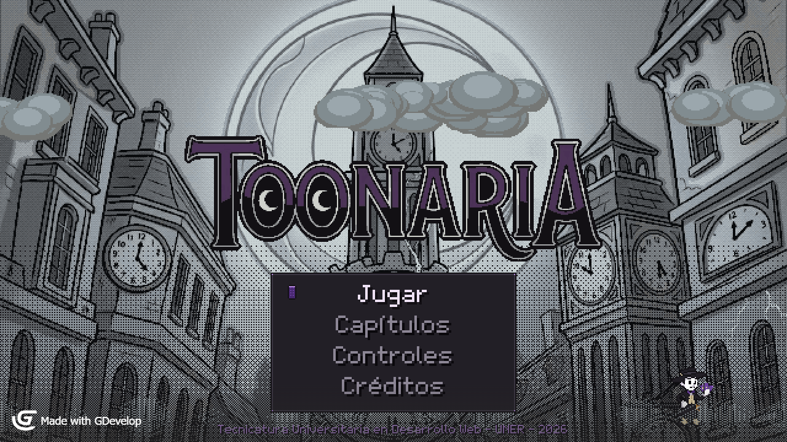
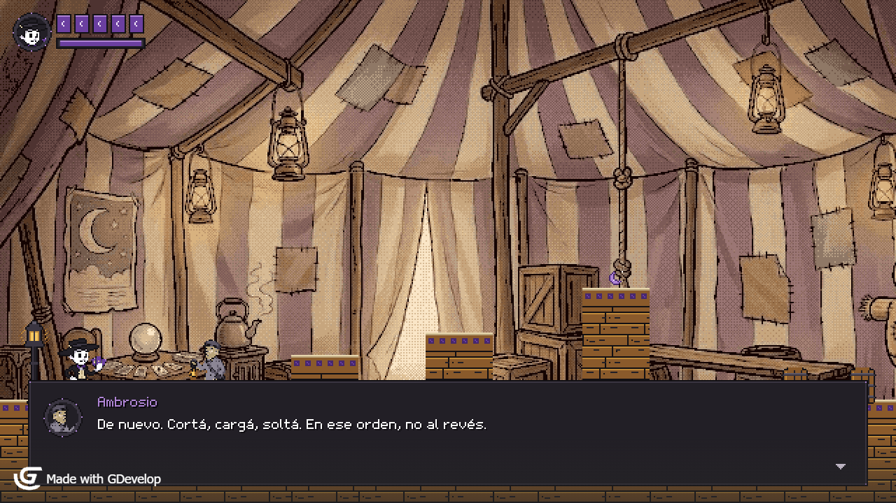
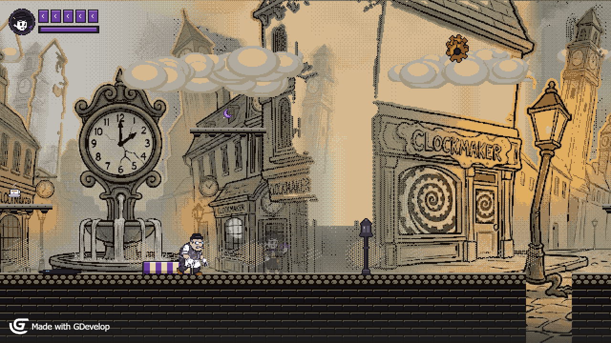
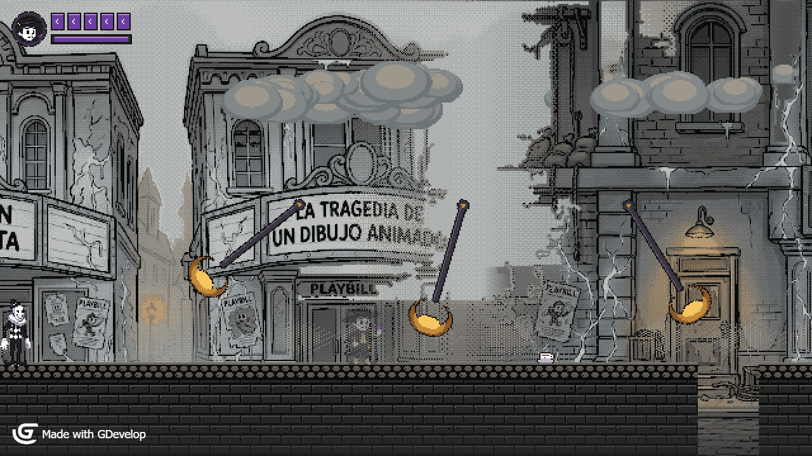
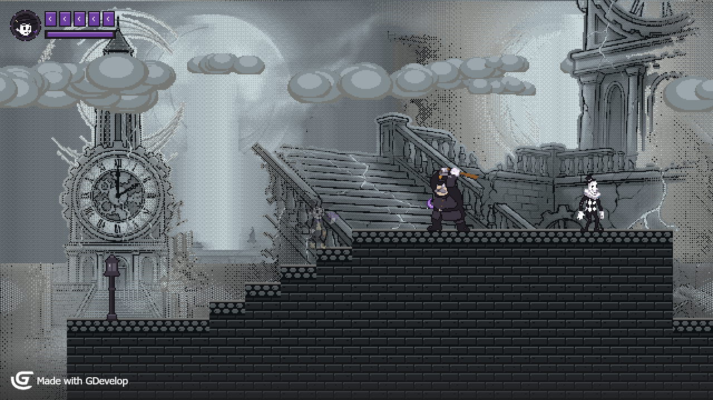
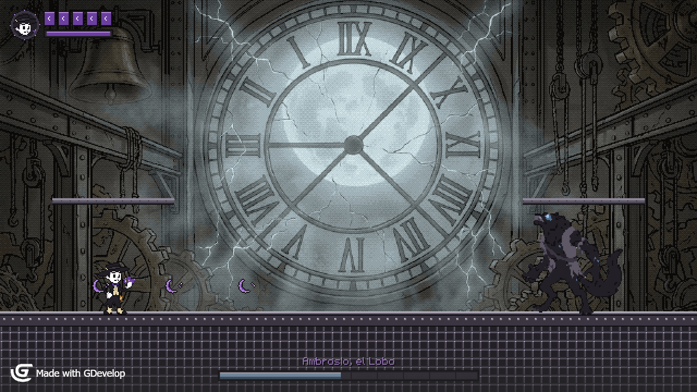
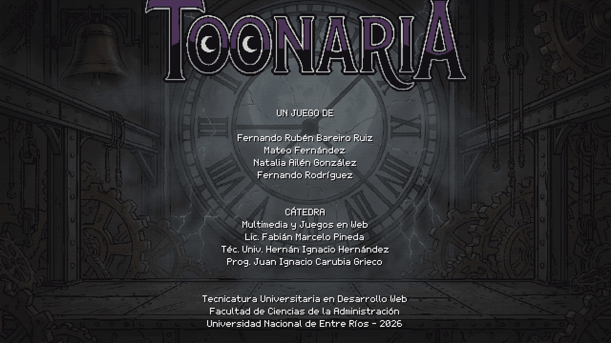
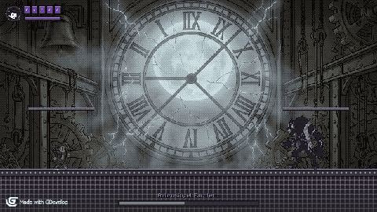

# Toonaria



**Plataformero de acción 2D en pixel art hecho en GDevelop 5.** Trabajo integrador de la
asignatura *Multimedia y Juegos en Web* — Tecnicatura Universitaria en Desarrollo Web, Facultad de
Ciencias de la Administración, Universidad Nacional de Entre Ríos (2026).

En Toonaria, una ciudad victoriana dibujada como un cartoon de los años 30, la luna llena
"repinta" a quienes la miran de más y los convierte en monstruos. **Ventura**, un cartomante que
pelea con cartas que se cargan, cruza la ciudad para encontrar a **Ambrosio**, el farolero que le
enseñó el oficio y que ahora es un lobo en la cima de la torre del reloj.

**Jugalo en el navegador**: [ferchulobo777.itch.io/toonaria-uner](https://ferchulobo777.itch.io/toonaria-uner)
(PC y celular).

**Equipo**: Fernando Rodríguez · Mateo Fernández · Natalia Ailén González · Fernando Rubén
Bareiro Ruiz.

---

## Contenido

- **Prólogo jugable** que funciona de tutorial: un recuerdo en la carpa de Ambrosio, donde cada
  estación enseña una acción.
- **Tres niveles** —Barrio del Reloj, Barrio de los Teatros y Corazón de Toonaria—, cada uno con
  enemigos y obstáculos nuevos que después se combinan con los anteriores.
- **Jefe final de dos fases** con ciclos de ataques que se aprenden y un parry que devuelve sus
  proyectiles.
- **Cuatro tipos de enemigo** (Repintado, Actor, Cuervo y Agente), cada uno con un aviso visual y
  sonoro propio antes de atacar.
- Diálogos con retratos, epílogo y créditos, menú de capítulos, música y efectos de sonido
  propios.

| | |
|---|---|
|  |  |
| *Prólogo — la carpa de Ambrosio* | *Nivel 1 — Barrio del Reloj* |
|  |  |
| *Nivel 2 — Barrio de los Teatros* | *Nivel 3 — El Corazón de Toonaria* |
|  |  |
| *La cima de la torre — Ambrosio* | *Créditos* |



## Cómo jugar

| Acción | Teclas |
|---|---|
| Moverse | Flechas o A / D |
| Saltar (doble salto en el aire) | Espacio o W — mantener para saltar más alto |
| Carta lunar | Mantener X o J para cargar, soltar para tirar |
| Farol incendiario | C o K |
| Parry (devuelve proyectiles) | Z o L, justo antes del golpe |
| Pasar diálogo | Enter |
| Pausa | Esc |

En **celular o tablet** aparecen botones en pantalla para todas las acciones.

Desde el título, **Capítulos** lleva directo a cualquier nivel o al jefe. Al terminar cada nivel,
una pantalla de resultados muestra el puntaje, el rango y el mejor puntaje guardado.

### Abrir el proyecto

1. Instalar [GDevelop 5](https://gdevelop.io/).
2. Abrir `juego/game.json` (*Abrir un proyecto*) y usar *Vista previa*.

### Exportar a web

En GDevelop: *Archivo → Exportar → Navegador web (HTML5)*. La carpeta exportada se sirve con
cualquier servidor estático, o se comprime en un ZIP para subirla a itch.io como juego HTML5.

## Estructura del repositorio

```
juego/                    Proyecto GDevelop
  game.json               Escenas, objetos y eventos
  assets/pixel/           Sprites, fondos, tiles, efectos y HUD en pixel art
  assets/sonido/          Efectos de sonido
  assets/musica/          Temas musicales
diseno/
  GDD.md / GDD.pdf        Documento de diseño (plantilla de la cátedra) y bitácora
  Guion.md                Guion y diálogos del juego
  Plan-de-Mejoras.md      Devolución del Game Test y plan por entrega
  Ficha-Personaje-Ventura.md
  arte/personajes/        Arte conceptual de personajes
  arte/escenarios/        Ilustraciones de cada barrio (base de los fondos)
  arte/logo/              Logo del juego
  capturas/               Capturas del juego
```

## Documentación

- [Documento de diseño (GDD)](diseno/GDD.md): mecánicas con sus números, enemigos, niveles, jefe,
  arte, sonido, implementación y la bitácora de decisiones.
- [Guion](diseno/Guion.md): la historia escena por escena y todos los diálogos del juego.
- [Ficha de personaje](diseno/Ficha-Personaje-Ventura.md).
- [Plan de mejoras](diseno/Plan-de-Mejoras.md): devolución de la cátedra y qué entra en cada entrega.

## Licencia

GPLv3 — ver [`LICENSE`](LICENSE).
